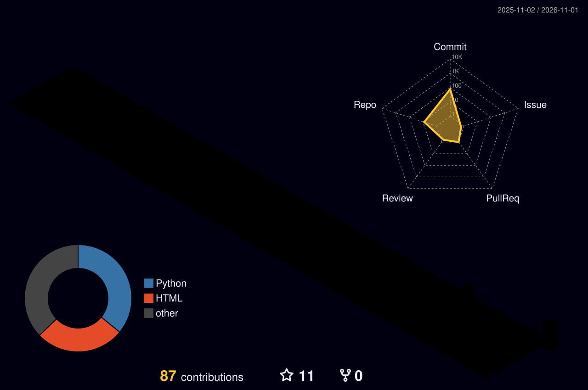

⚡ PROJECT AEGIS — AI & COMPUTER SCIENCE

  

  

  <strong>AI Enthusiast | Computer Science Student | Developer</strong>

  
  

---

🧬 01 — DEVELOPER IDENTITY

name: Mohammed Saaqib Mohiddin
role: BTech Computer Science & Engineering Student
specialization: Artificial Intelligence
graduation: 2027

interests:
  - Artificial Intelligence
  - Generative AI
  - Machine Learning
  - Deep Learning
  - Natural Language Processing
  - Python Development
  - Full-Stack Development

currently_learning:
  - Large Language Models
  - Retrieval-Augmented Generation
  - AI Application Development
  - Advanced Python

mission: Build intelligent solutions for real-world problems.

🎯 02 — ABOUT ME

Hello! I am a Computer Science and Engineering student specializing in Artificial Intelligence.

I am passionate about exploring emerging technologies and developing practical applications using programming and AI.

- 🎓 Pursuing BTech in Computer Science and Engineering (AI).
- 🤖 Interested in Artificial Intelligence and Generative AI.
- 🐍 Working with Python and modern development technologies.
- 🧠 Exploring Machine Learning, Deep Learning and NLP.
- 💻 Building projects that solve real-world problems.
- 🚀 Continuously learning and improving my technical skills.

My goal: Become an AI-focused software developer and build useful, intelligent applications.

🎓 03 — EDUCATION

BTech — Computer Science and Engineering (Artificial Intelligence)

Audisankara College of Engineering and Technology, Gudur, Andhra Pradesh

- University: JNTU Anantapur
- Duration: 2023 – 2027
- Specialization: Artificial Intelligence

⚙️ 04 — TECHNOLOGY ARSENAL

Programming Languages

  

Frontend Development

  

Backend & Frameworks

  

Databases

  

AI & Data Science

- Artificial Intelligence
- Generative AI
- Machine Learning
- Deep Learning
- Natural Language Processing
- Large Language Models
- Retrieval-Augmented Generation
- NumPy, Pandas, Matplotlib and Scikit-learn

Tools & Platforms

  

🚀 05 — FEATURED PROJECTS

Projects developed to improve my programming skills and explore practical applications.

01. Inventory Management System

A web-based application for managing inventory information and operations.

- Technologies: HTML, CSS, JavaScript
- Live Demo: "Open Project" (https://saaqibmohiddin.github.io/Inventory-Management/)
- Source Code: "GitHub Repository" (https://github.com/saaqibmohiddin/Inventory-Management)

02. AI Learning Path Generator

An application designed to help learners explore structured learning paths.

- Technologies: AI-focused application development
- Live Demo: "Open Project" (https://saaqibmohiddin.github.io/AI-Learning-Path-Generator/)
- Source Code: "GitHub Repository" (https://github.com/saaqibmohiddin/AI-Learning-Path-Generator)

03. Smart Hospital Queue

A project focused on improving hospital queue management.

- Technologies: Web Development
- Live Demo: "Open Project" (https://saaqibmohiddin.github.io/Smart-Hospital-Queue/)
- Source Code: "GitHub Repository" (https://github.com/saaqibmohiddin/Smart-Hospital-Queue)

04. AI Language Translator

An application focused on language translation.

- Technologies: AI-focused application development
- Live Demo: "Open Project" (https://saaqibmohiddin.github.io/AI-Language-Translator/)
- Source Code: "GitHub Repository" (https://github.com/saaqibmohiddin/AI-Language-Translator)

05. Banking Management System

A project for managing basic banking operations.

- Technologies: Programming and application development
- Live Demo: "Open Project" (https://saaqibmohiddin.github.io/Banking-Management-System/)
- Source Code: "GitHub Repository" (https://github.com/saaqibmohiddin/Banking-Management-System)

06. Student Management System

An application for organizing and managing student information.

- Technologies: Web Development
- Live Demo: "Open Project" (https://saaqibmohiddin.github.io/Student-Management-System/)
- Source Code: "GitHub Repository" (https://github.com/saaqibmohiddin/Student-Management-System)

07. Python ChatBot

A chatbot project exploring conversational interaction using Python.

- Technologies: Python
- Live Demo: "Open Project" (https://saaqibmohiddin.github.io/Python-ChatBot/)
- Source Code: "GitHub Repository" (https://github.com/saaqibmohiddin/Python-ChatBot)

🏆 06 — CERTIFICATIONS & ACHIEVEMENTS

Tata — GenAI Powered Data Analytics Job Simulation

  

- Provider: Tata through Forage
- Completed: July 25, 2026
- Skills explored: Exploratory Data Analysis, AI risk profiling, delinquency prediction, data storytelling and AI-driven collections strategy.

BCG X — GenAI Job Simulation

  

- Provider: BCG X through Forage
- Completed: September 4, 2026
- Skills explored: Data extraction, initial analysis and AI-powered financial chatbot development.

IBM SkillsBuild — AI Literacy

  

- Provider: IBM SkillsBuild
- Issued: September 4, 2026
- Focus: AI fundamentals, AI concepts and applications, and responsible AI awareness.

📊 07 — GITHUB PERFORMANCE

  
  

  

🐍 08 — CONTRIBUTION ACTIVITY

  

🌌 09 — 3D CONTRIBUTION GRAPH

  

🧠 10 — CURRENT LEARNING ROADMAP

Area| Learning Focus
Python| Advanced Python and application development
Generative AI| LLMs, prompt engineering and AI applications
Machine Learning| Algorithms and model development
Deep Learning| Neural networks and model training
NLP| Text processing and language applications
RAG| Knowledge-based AI applications
Full-Stack| Frontend, backend and API integration

🎯 11 — FUTURE OBJECTIVES

- Build practical AI-powered applications.
- Develop stronger Machine Learning and Deep Learning skills.
- Explore LLMs and Retrieval-Augmented Generation.
- Contribute to open-source projects.
- Improve software development and problem-solving skills.
- Prepare for opportunities in AI and software development.

🤝 12 — CONNECT WITH ME

  
  
  

  <strong>Open to learning, collaboration, internships and AI project opportunities.</strong>

---

  

  <strong>⚡ PROJECT AEGIS — THINK • BUILD • INNOVATE</strong>

  Designed with curiosity. Built with code. Driven by innovation.

