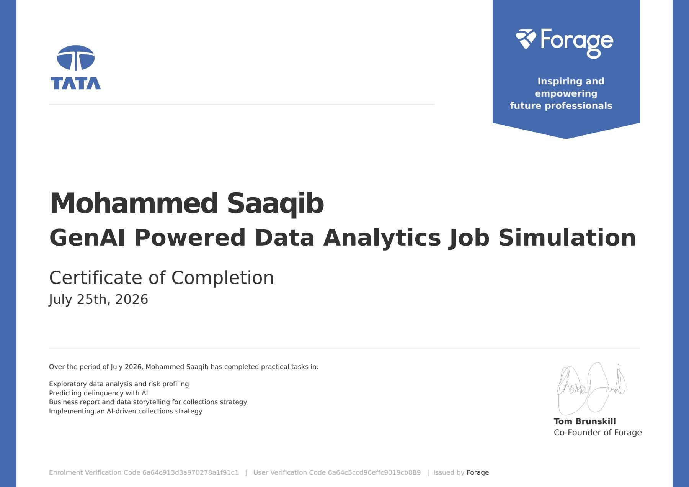
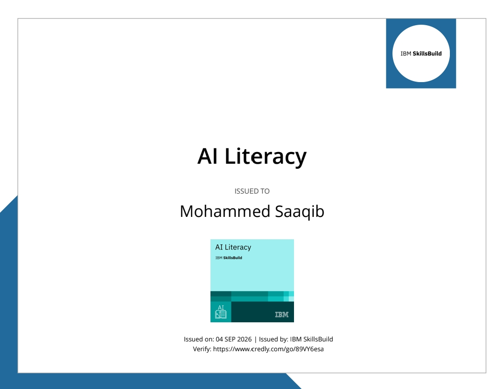
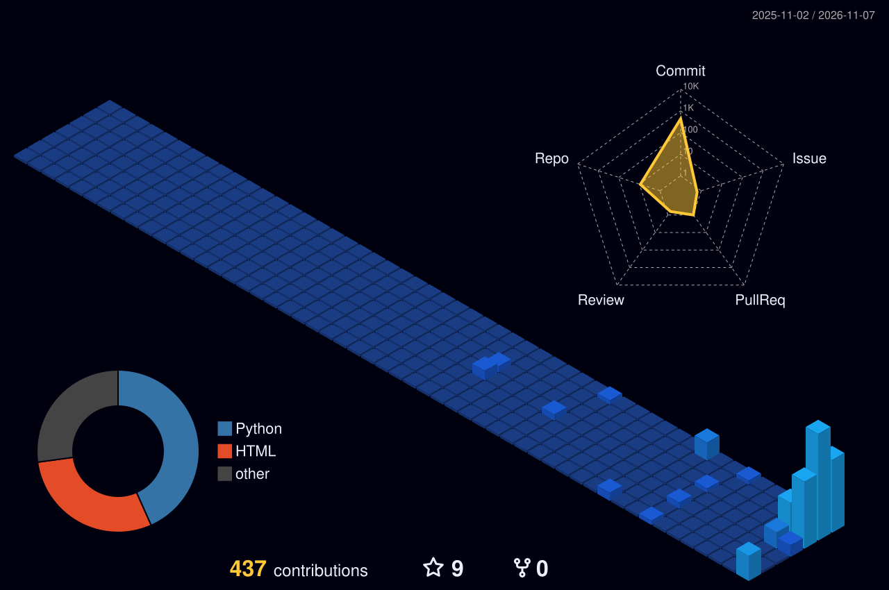

#  MOHAMMED SAAQIB MOHIDDIN

<div align="center">


<a href="https://github.com/saaqibmohiddin">

</a>

**Building intelligent solutions. Engineering digital experiences. Exploring the future of technology.**

[](https://github.com/saaqibmohiddin)
[](https://www.linkedin.com/in/mohammed-saaqib-mohiddin-89b434269/)
[](mailto:msaaqib777@gmail.com)


</div>

---

## ◈ 01 — DEVELOPER IDENTITY

```yaml
name: Mohammed Saaqib Mohiddin
username: saaqibmohiddin
role: Developer

focus:
  - Artificial Intelligence
  - Generative AI
  - Machine Learning
  - Deep Learning
  - Natural Language Processing
  - Python Development
  - Full-Stack Development

mindset: Learn | Build | Innovate | Improve
```


## ◈ 02 — ABOUT ME

<div align="center">BUILDING INTELLIGENCE. CREATING IMPACT.

AI Engineer | Python Developer | Full-Stack Developer

</div>I'm passionate about Artificial Intelligence, software development and emerging technologies. I enjoy building practical applications, exploring intelligent solutions and transforming ideas into functional projects.

My interests include programming, developing AI-powered applications, solving technical challenges and continuously expanding my knowledge of modern technologies.

---

◈ AREAS OF INTEREST

<div align="center">


</div>◈ DEVELOPMENT FOCUS

DOMAIN| FOCUS
Artificial Intelligence| Intelligent applications
Generative AI| LLMs and AI-powered solutions
Python Development| Application development
Web Development| Frontend and backend technologies
Problem Solving| Practical programming projects

<div align="center">LEARN • BUILD • INNOVATE

</div>---


---


## ◈ 03 — EDUCATION & ACADEMIC PROFILE

<div align="center">

<table width="100%">
<tr>
<td align="center">

<h2>🎓 BACHELOR OF TECHNOLOGY</h2>

<h3>COMPUTER SCIENCE AND ENGINEERING</h3>


</td>
</tr>
</table>

<table width="100%">
<tr>
<td width="60%" align="center">
<h3>◈ COLLEGE</h3>
<strong>Audisankara College of Engineering and Technology</strong>
</td>
<td width="40%" align="center">
<h3>◈ UNIVERSITY</h3>
<strong>JNTU Anantapur</strong>
</td>
</tr>
<tr>
<td width="60%" align="center">
<h3>◈ LOCATION</h3>
<strong>Gudur, Andhra Pradesh, India</strong>
</td>
<td width="40%" align="center">
<h3>◈ DURATION</h3>
<strong>2023 – 2027</strong>
</td>
</tr>
</table>

<p align="center">


</p>

</div>

---


---


## ◈ 04 — TECHNOLOGY ECOSYSTEM

<div align="center">

### PROGRAMMING LANGUAGES


### FRONTEND DEVELOPMENT


### BACKEND DEVELOPMENT


### DATABASE TECHNOLOGIES


### DEVELOPER TOOLS


</div>

**AI & MACHINE LEARNING**

`Artificial Intelligence` · `Machine Learning` · `Deep Learning` · `Generative AI` · `NLP` · `LLMs`

**PYTHON LIBRARIES**

`NumPy` · `Pandas` · `Matplotlib` · `Scikit-learn`

**OTHER TECHNOLOGIES**

`Streamlit` · `Tkinter` · `REST APIs` · `SQL`

---

## ◈ 05 — TECHNOLOGY SHOWCASE

<table>
<tr>
<td width="50%" valign="top">

### 🧠 Artificial Intelligence

- Artificial Intelligence
- Machine Learning
- Deep Learning
- Natural Language Processing

</td>
<td width="50%" valign="top">

### ✨ Generative AI

- Generative AI
- Large Language Models
- AI-powered applications
- Intelligent automation

</td>
</tr>
<tr>
<td width="50%" valign="top">

### 🐍 Python Ecosystem

- Python
- NumPy
- Pandas
- Matplotlib
- Scikit-learn

</td>
<td width="50%" valign="top">

### 🎨 Frontend Engineering

- HTML5
- CSS3
- JavaScript
- React.js
- Bootstrap

</td>
</tr>
<tr>
<td width="50%" valign="top">

### ⚙️ Backend Engineering

- Python
- Flask
- Django
- FastAPI
- REST APIs

</td>
<td width="50%" valign="top">

### 🗄️ Database Engineering

- MySQL
- PostgreSQL
- SQLite

</td>
</tr>
</table>

---

## ◈ 06 — FEATURED PROJECTS

<table>
<tr>
<td width="50%" valign="top">

### 📦 Inventory Management System

Software project focused on inventory management.

[🚀 Live Demo](https://saaqibmohiddin.github.io/Inventory-Management/)

[📂 Source Code](https://github.com/saaqibmohiddin/Inventory-Management)

</td>
<td width="50%" valign="top">

### 🤖 AI Learning Path Generator

AI-oriented project focused on generating learning paths.

[🚀 Live Demo](https://saaqibmohiddin.github.io/AI-Learning-Path-Generator/)

[📂 Source Code](https://github.com/saaqibmohiddin/AI-Learning-Path-Generator)

</td>
</tr>
<tr>
<td width="50%" valign="top">

### 🏥 Smart Hospital Queue

Software project focused on hospital queue management.

[🚀 Live Demo](https://saaqibmohiddin.github.io/Smart-Hospital-Queue/)

[📂 Source Code](https://github.com/saaqibmohiddin/Smart-Hospital-Queue)

</td>
<td width="50%" valign="top">

### 🌐 AI Language Translator

AI-oriented language translation project.

[🚀 Live Demo](https://saaqibmohiddin.github.io/AI-Language-Translator/)

[📂 Source Code](https://github.com/saaqibmohiddin/AI-Language-Translator)

</td>
</tr>
<tr>
<td width="50%" valign="top">

### 🏦 Banking Management System

Banking management software project.

[🚀 Live Demo](https://saaqibmohiddin.github.io/Banking-Management-System/)

[📂 Source Code](https://github.com/saaqibmohiddin/Banking-Management-System)

</td>
<td width="50%" valign="top">

### 🎓 Student Management System

Student management software project.

[🚀 Live Demo](https://saaqibmohiddin.github.io/Student-Management-System/)

[📂 Source Code](https://github.com/saaqibmohiddin/Student-Management-System)

</td>
</tr>
</table>

<div align="center">

### 💬 Python ChatBot

[🚀 Live Demo](https://saaqibmohiddin.github.io/Python-ChatBot/)

[📂 Source Code](https://github.com/saaqibmohiddin/Python-ChatBot)

</div>

---

## ◈ 07 — CERTIFICATION VAULT

<p align="center">
  
</p>

### 01 / TATA

<p align="center">
  
</p>

**GenAI Powered Data Analytics Job Simulation**

<sub>Forage · 25 July 2026</sub>

---

### 02 / BCG X

<p align="center">
  
</p>

**GenAI Job Simulation**

<sub>Forage · 04 September 2026</sub>

---

### 03 / IBM SKILLSBUILD

<p align="center">
  
</p>

**AI Literacy**

<sub>IBM SkillsBuild · 04 September 2026</sub>

---

<p align="center">
  <sub>LEARN · BUILD · INNOVATE · GROW</sub>
</p>

---


## ◈ 08 — GITHUB ANALYTICS COMMAND CENTER

<div align="center">


### Contribution Streak


</div>


---

## ◈ 09 — CONTRIBUTION ACTIVITY

<div align="center">


### 📅 GITHUB CONTRIBUTION CALENDAR

<div align="center">


</div>


### 🐍 GITHUB SNAKE ANIMATION

<picture>
  <source media="(prefers-color-scheme: dark)" srcset="https://raw.githubusercontent.com/saaqibmohiddin/saaqibmohiddin/output/snake-dark.svg">
  <source media="(prefers-color-scheme: light)" srcset="https://raw.githubusercontent.com/saaqibmohiddin/saaqibmohiddin/output/snake.svg">
  
</picture>

---


<!-- PAC-MAN CONTRIBUTION ANIMATION -->

<div align="center">

  <h3>👾 PAC-MAN CONTRIBUTION ANIMATION</h3>

  <p>
    <b>⚡ WATCH PAC-MAN EAT YOUR GITHUB CONTRIBUTIONS ⚡</b>
  </p>

  <picture>
    <source
      media="(prefers-color-scheme: dark)"
      srcset="https://raw.githubusercontent.com/saaqibmohiddin/saaqibmohiddin/pacman-output/pacman-contribution-graph-dark.svg"
    />
    <source
      media="(prefers-color-scheme: light)"
      srcset="https://raw.githubusercontent.com/saaqibmohiddin/saaqibmohiddin/pacman-output/pacman-contribution-graph.svg"
    />
    
  </picture>

  <br/>

  <p>
    <b>🎮 GAME ON! EAT THE CONTRIBUTIONS. CHASE THE FUTURE.</b>
  </p>

</div>

<!-- END PAC-MAN CONTRIBUTION ANIMATION -->

---

## ◈ 3D CONTRIBUTION GRAPH

<div align="center">



</div>

---

## ◈ 10 — DEVELOPER COMMAND CENTER

```text
┌──────────────────────────────────────────┐
│       SAAQIB MOHIDDIN // TERMINAL        │
└──────────────────────────────────────────┘

$ whoami
Mohammed Saaqib Mohiddin

$ skills
Python | Java | JavaScript | SQL
React | Flask | Django | FastAPI

$ interests
AI | ML | Deep Learning | GenAI | NLP

$ projects
Explore my seven featured projects.


$ github
github.com/saaqibmohiddin

$ contact
msaaqib777@gmail.com

$ about
Learn. Build. Innovate. Repeat.
```

<sub>Static terminal-inspired presentation. Commands are illustrative and do not execute inside GitHub README.</sub>

---


## ◈ 11 — AI DEVELOPER INTELLIGENCE HUB

<div align="center">


</div>

### Technology Radar

| Domain | Technologies |
|---|---|
| Artificial Intelligence | AI, ML, Deep Learning, NLP |
| Generative AI | GenAI, LLMs |
| Python Development | Python, NumPy, Pandas |
| Frontend | HTML, CSS, JavaScript, React |
| Backend | Flask, Django, FastAPI |
| Databases | MySQL, PostgreSQL, SQLite |
| Developer Tools | Git, GitHub, VS Code |

---

## ◈ 12 — REPOSITORY SPOTLIGHT

<div align="center">

<a href="https://github.com/saaqibmohiddin/Inventory-Management">


<a href="https://github.com/saaqibmohiddin/AI-Learning-Path-Generator">


<a href="https://github.com/saaqibmohiddin/Smart-Hospital-Queue">


<a href="https://github.com/saaqibmohiddin/AI-Language-Translator">


[Explore All Public Repositories →](https://github.com/saaqibmohiddin?tab=repositories)

</div>

---


## ◈ 13 — GITHUB STATISTICS DASHBOARD

<div align="center"></div>---

---

## ◈ 14 – CURRENT FOCUS & LEARNING ROADMAP

<div align="center">

### 🚀 WHAT I'M FOCUSING ON

| Technology | Focus |
|:---|:---|
| Python | Advanced Python |
| Artificial Intelligence | AI Applications |
| Machine Learning | ML Models |
| Generative AI | LLMs & RAG |
| Deep Learning | Neural Networks |
| Full Stack Development | React & FastAPI |

### 🎯 MY NEXT GOALS

- Build real-world AI applications.
- Develop advanced GenAI projects.
- Improve problem-solving skills.
- Contribute to open-source projects.
- Explore new AI technologies.

### 💡 LEARN. BUILD. GROW.

</div>

## ◈ 15 — CONNECT WITH ME

<div align="center">

### LET'S BUILD SOMETHING INNOVATIVE!

I'm interested in technology, software development, Artificial Intelligence, and innovative ideas.

<a href="https://github.com/saaqibmohiddin">

</a>

<a href="https://www.linkedin.com/in/mohammed-saaqib-mohiddin-89b434269/">

</a>

<a href="mailto:msaaqib777@gmail.com">

</a>

**GitHub:** [@saaqibmohiddin](https://github.com/saaqibmohiddin)

**LinkedIn:** [Connect with me](https://www.linkedin.com/in/mohammed-saaqib-mohiddin-89b434269/)

**Email:** [msaaqib777@gmail.com](mailto:msaaqib777@gmail.com)

</div>

---

<div align="center">


<a href="#-mohammed-saaqib-mohiddin">⬆ BACK TO TOP</a>

</div>