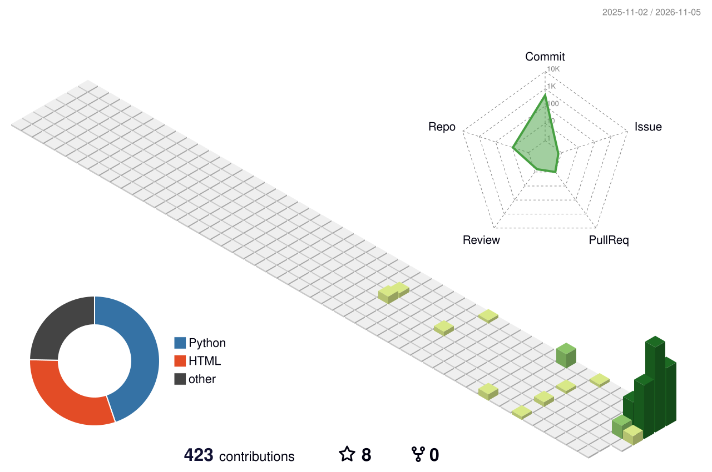

MOHAMMED SAAQIB MOHIDDIN

INTELLIGENCE. INNOVATION. ENGINEERING. DIGITAL DEFENCE.

Building intelligent solutions. Engineering practical applications. Exploring the future of technology.

""GitHub" (https://img.shields.io/badge/GitHub-Profile-030712?style=for-the-badge&logo=github&logoColor=00E5FF)" (https://github.com/saaqibmohiddin)
""LinkedIn" (https://img.shields.io/badge/LinkedIn-Connect-2563EB?style=for-the-badge&logo=linkedin&logoColor=white)" (https://www.linkedin.com/in/mohammed-saaqib-mohiddin-89b434269/)
""Email" (https://img.shields.io/badge/Email-Contact-8B5CF6?style=for-the-badge&logo=gmail&logoColor=white)" (mailto:msaaqib777@gmail.com)

"Profile Views" (https://komarev.com/ghpvc/?username=saaqibmohiddin&style=for-the-badge&color=2563EB&label=PROFILE+VIEWS)
"Followers" (https://img.shields.io/github/followers/saaqibmohiddin?style=for-the-badge&logo=github&color=00E5FF)
"Stars" (https://img.shields.io/github/stars/saaqibmohiddin?style=for-the-badge&logo=github&color=8B5CF6)

---

◈ 01 — AEGIS IDENTITY PROFILE

identity:
  name: Mohammed Saaqib Mohiddin
  username: saaqibmohiddin
  designation: Developer
  domain: AI and Software Engineering

primary_focus:
  - Artificial Intelligence
  - Generative AI
  - Machine Learning
  - Deep Learning
  - Natural Language Processing
  - Python Development
  - Full-Stack Development

mission:
  - Build intelligent applications
  - Engineer practical software solutions
  - Explore emerging technologies
  - Continuously improve technical skills

operating_principle: Learn | Build | Innovate | Improve

◈ 02 — ABOUT THE DEVELOPER

I'm a Computer Science and Engineering student specializing in Artificial Intelligence, passionate about building practical software solutions and exploring emerging technologies.

My interests include Artificial Intelligence, Generative AI, Machine Learning, Python Development, and Full-Stack Engineering.

Core activities

- Develop Python-based applications.
- Explore Artificial Intelligence and Machine Learning.
- Build Generative AI concepts and applications.
- Develop frontend and backend applications.
- Work with databases and REST APIs.
- Explore practical software engineering solutions.

Current exploration

"Generative AI" · "LLMs" · "Deep Learning" · "NLP" · "AI Applications" · "Modern Software Engineering"

---

◈ 03 — EDUCATION & ACADEMIC PROFILE

BACHELOR OF TECHNOLOGY — B.TECH

Computer Science and Engineering

Specialization: Artificial Intelligence

College: Audisankara College of Engineering and Technology

Location: Gudur, Andhra Pradesh, India

University: Jawaharlal Nehru Technological University Anantapur (JNTUA)

Academic Duration: 2023 – 2027

---

◈ 04 — TECHNOLOGY ECOSYSTEM

PROGRAMMING LANGUAGES

FRONTEND DEVELOPMENT

BACKEND DEVELOPMENT

DATABASE TECHNOLOGIES

DEVELOPER TOOLS

AI & MACHINE LEARNING

"Artificial Intelligence" · "Machine Learning" · "Deep Learning" · "Generative AI" · "NLP" · "LLMs"

PYTHON LIBRARIES

"NumPy" · "Pandas" · "Matplotlib" · "Scikit-learn"

OTHER TECHNOLOGIES

"Streamlit" · "Tkinter" · "REST APIs" · "SQL"

---

◈ 05 — TECHNICAL CAPABILITY MATRIX

<table>
<tr>
<td width="50%" valign="top">🧠 Artificial Intelligence

- Artificial Intelligence
- Machine Learning
- Deep Learning
- Natural Language Processing

</td>
<td width="50%" valign="top">✨ Generative AI

- Generative AI
- Large Language Models
- AI-powered applications
- Intelligent automation

</td>
</tr>
<tr>
<td width="50%" valign="top">🐍 Python Ecosystem

- Python
- NumPy
- Pandas
- Matplotlib
- Scikit-learn

</td>
<td width="50%" valign="top">🎨 Frontend Engineering

- HTML5
- CSS3
- JavaScript
- React.js
- Bootstrap

</td>
</tr>
<tr>
<td width="50%" valign="top">⚙️ Backend Engineering

- Python
- Flask
- Django
- FastAPI
- REST APIs

</td>
<td width="50%" valign="top">🗄️ Database Engineering

- MySQL
- PostgreSQL
- SQLite

</td>
</tr>
</table>---

◈ 06 — PROJECT OPERATIONS CENTER

Selected software and AI-oriented projects.

<table>
<tr>
<td width="50%" valign="top">📦 Inventory Management System

Software project focused on inventory management.

"🚀 Live Demo" (https://saaqibmohiddin.github.io/Inventory-Management/)

"📂 Source Code" (https://github.com/saaqibmohiddin/Inventory-Management)

</td>
<td width="50%" valign="top">🤖 AI Learning Path Generator

AI-oriented project focused on generating learning paths.

"🚀 Live Demo" (https://saaqibmohiddin.github.io/AI-Learning-Path-Generator/)

"📂 Source Code" (https://github.com/saaqibmohiddin/AI-Learning-Path-Generator)

</td>
</tr>
<tr>
<td width="50%" valign="top">🏥 Smart Hospital Queue

Software project focused on hospital queue management.

"🚀 Live Demo" (https://saaqibmohiddin.github.io/Smart-Hospital-Queue/)

"📂 Source Code" (https://github.com/saaqibmohiddin/Smart-Hospital-Queue)

</td>
<td width="50%" valign="top">🌐 AI Language Translator

AI-oriented language translation project.

"🚀 Live Demo" (https://saaqibmohiddin.github.io/AI-Language-Translator/)

"📂 Source Code" (https://github.com/saaqibmohiddin/AI-Language-Translator)

</td>
</tr>
<tr>
<td width="50%" valign="top">🏦 Banking Management System

Banking management software project.

"🚀 Live Demo" (https://saaqibmohiddin.github.io/Banking-Management-System/)

"📂 Source Code" (https://github.com/saaqibmohiddin/Banking-Management-System)

</td>
<td width="50%" valign="top">🎓 Student Management System

Student management software project.

"🚀 Live Demo" (https://saaqibmohiddin.github.io/Student-Management-System/)

"📂 Source Code" (https://github.com/saaqibmohiddin/Student-Management-System)

</td>
</tr>
</table>
💬 Python ChatBot

Python-based chatbot project.

"🚀 Live Demo" (https://saaqibmohiddin.github.io/Python-ChatBot/)

"📂 Source Code" (https://github.com/saaqibmohiddin/Python-ChatBot)

---

◈ 07 — CERTIFICATIONS & PROFESSIONAL LEARNING

🔵 01 — TATA | GenAI Powered Data Analytics Job Simulation

Organization: Tata through Forage

Completion Date: July 25, 2026

Skills: Exploratory Data Analysis, AI Risk Profiling, Delinquency Prediction, Data Storytelling, AI-driven Collections Strategy.

---

🟢 02 — BCG X | GenAI Job Simulation

Organization: BCG X through Forage

Completion Date: September 4, 2026

Skills: Data Extraction, Initial Data Analysis, AI-powered Financial Chatbot Development.

---

🔷 03 — IBM SkillsBuild | AI Literacy

Organization: IBM SkillsBuild

Completion Date: September 4, 2026

Skills and Learning Areas:

- Artificial Intelligence Fundamentals
- Understanding AI Concepts and Applications
- Machine Learning Fundamentals
- Generative AI Awareness
- Responsible and Ethical AI
- AI in Real-World Applications

---

◈ 08 — GITHUB ANALYTICS COMMAND CENTER

PROFILE STATISTICS

CONTRIBUTION STREAK

GITHUB ACTIVITY

ACHIEVEMENT WALL

---

◈ 09 — CONTRIBUTION ACTIVITY SYSTEM

🐍 GITHUB SNAKE ANIMATION

<picture>
  <source media="(prefers-color-scheme: dark)" srcset="https://raw.githubusercontent.com/saaqibmohiddin/saaqibmohiddin/output/snake-dark.svg">
  <source media="(prefers-color-scheme: light)" srcset="https://raw.githubusercontent.com/saaqibmohiddin/saaqibmohiddin/output/snake.svg">
  
</picture>---

👾 PAC-MAN CONTRIBUTION ANIMATION

WATCH PAC-MAN EAT YOUR GITHUB CONTRIBUTIONS

<picture>
  <source media="(prefers-color-scheme: dark)" srcset="https://raw.githubusercontent.com/saaqibmohiddin/saaqibmohiddin/pacman-output/pacman-contribution-graph-dark.svg"/>
  <source media="(prefers-color-scheme: light)" srcset="https://raw.githubusercontent.com/saaqibmohiddin/saaqibmohiddin/pacman-output/pacman-contribution-graph.svg"/>
  
</picture>GAME ON! EAT THE CONTRIBUTIONS. CHASE THE FUTURE.

---

◈ 10 — DEVELOPER COMMAND CENTER

┌──────────────────────────────────────────────────┐
│          PROJECT AEGIS // DEVELOPER TERMINAL     │
└──────────────────────────────────────────────────┘

$ whoami
Mohammed Saaqib Mohiddin

$ designation
Computer Science & Engineering | AI Specialization

$ skills
Python | Java | JavaScript | SQL
React | Flask | Django | FastAPI

$ intelligence_domains
AI | ML | Deep Learning | GenAI | NLP | LLMs

$ projects
7 Featured Software and AI Projects

$ education
B.Tech CSE (Artificial Intelligence)
2023 - 2027

$ github
github.com/saaqibmohiddin

$ contact
msaaqib777@gmail.com

$ mission
Learn. Build. Innovate. Improve.

Static terminal-inspired presentation. Commands are illustrative and do not execute inside GitHub README.

---

◈ 11 — 3D CONTRIBUTION VISUALIZATION

---

◈ 12 — AI DEVELOPER INTELLIGENCE HUB

"AI" (https://img.shields.io/badge/ARTIFICIAL_INTELLIGENCE-030712?style=for-the-badge&logo=probot&logoColor=00E5FF)
"GenAI" (https://img.shields.io/badge/GENERATIVE_AI-030712?style=for-the-badge&logo=openai&logoColor=00E5FF)
"ML" (https://img.shields.io/badge/MACHINE_LEARNING-030712?style=for-the-badge&logo=scikitlearn&logoColor=2563EB)
"DL" (https://img.shields.io/badge/DEEP_LEARNING-030712?style=for-the-badge&logo=pytorch&logoColor=8B5CF6)
"NLP" (https://img.shields.io/badge/NLP-030712?style=for-the-badge&logo=googletranslate&logoColor=00E5FF)
"LLMs" (https://img.shields.io/badge/LLMs-030712?style=for-the-badge&logo=openai&logoColor=DCE6F1)

TECHNOLOGY RADAR

Domain| Technologies
Artificial Intelligence| AI, ML, Deep Learning, NLP
Generative AI| GenAI, LLMs
Python Development| Python, NumPy, Pandas, Matplotlib
Frontend| HTML, CSS, JavaScript, React
Backend| Flask, Django, FastAPI
Databases| MySQL, PostgreSQL, SQLite
Developer Tools| Git, GitHub, VS Code

---

◈ 13 — REPOSITORY SPOTLIGHT

"EXPLORE ALL PUBLIC REPOSITORIES →" (https://github.com/saaqibmohiddin?tab=repositories)

---

◈ 14 — DEVELOPER JOURNEY

Explore my development work and progress through these GitHub resources:

- "Public Repositories" (https://github.com/saaqibmohiddin?tab=repositories)
- "Project Releases" (https://github.com/saaqibmohiddin?tab=repositories)
- "Contribution Activity" (https://github.com/saaqibmohiddin)
- "Project Demonstrations" (#-06--project-operations-center)
- "AI Repositories" (https://github.com/saaqibmohiddin?tab=repositories&q=AI)
- "Python Repositories" (https://github.com/saaqibmohiddin?tab=repositories&q=Python)

---

◈ 15 — PROJECT RESOURCE DIRECTORY

Resource| Destination
Project Portfolio| "Featured Projects" (#-06--project-operations-center)
AI Projects| "AI Repositories" (https://github.com/saaqibmohiddin?tab=repositories&q=AI)
Python Projects| "Python Repositories" (https://github.com/saaqibmohiddin?tab=repositories&q=Python)
All Source Code| "GitHub Repositories" (https://github.com/saaqibmohiddin?tab=repositories)
Professional Profile| "LinkedIn" (https://www.linkedin.com/in/mohammed-saaqib-mohiddin-89b434269/)
Contact| "Email" (mailto:msaaqib777@gmail.com)

---

◈ 16 — CURRENT FOCUS & LEARNING ROADMAP

🚀 CURRENT LEARNING PRIORITIES

Technology| Focus Area
Python| Advanced Python Development
Artificial Intelligence| Practical AI Applications
Machine Learning| ML Models
Generative AI| LLMs and RAG
Deep Learning| Neural Networks
Full-Stack Development| React and FastAPI

🎯 NEXT DEVELOPMENT GOALS

- Build real-world AI applications.
- Develop advanced Generative AI projects.
- Improve problem-solving skills.
- Contribute to open-source projects.
- Explore emerging AI technologies.
- Strengthen software development skills.

LEARN. BUILD. GROW.

---

◈ 17 — CONNECT WITH THE DEVELOPER

LET'S BUILD SOMETHING INNOVATIVE!

I'm interested in technology, software development, Artificial Intelligence, and innovative ideas.

GitHub: "@saaqibmohiddin" (https://github.com/saaqibmohiddin)

LinkedIn: "Connect with me" (https://www.linkedin.com/in/mohammed-saaqib-mohiddin-89b434269/)

Email: "msaaqib777@gmail.com" (mailto:msaaqib777@gmail.com)

---

PROJECT AEGIS — INTELLIGENCE THROUGH INNOVATION

THINK. BUILD. INNOVATE. PROTECT.

Designed with a vision for Artificial Intelligence, software engineering, and the future of technology.

"⬆ BACK TO TOP" (#-mohammed-saaqib-mohiddin)

